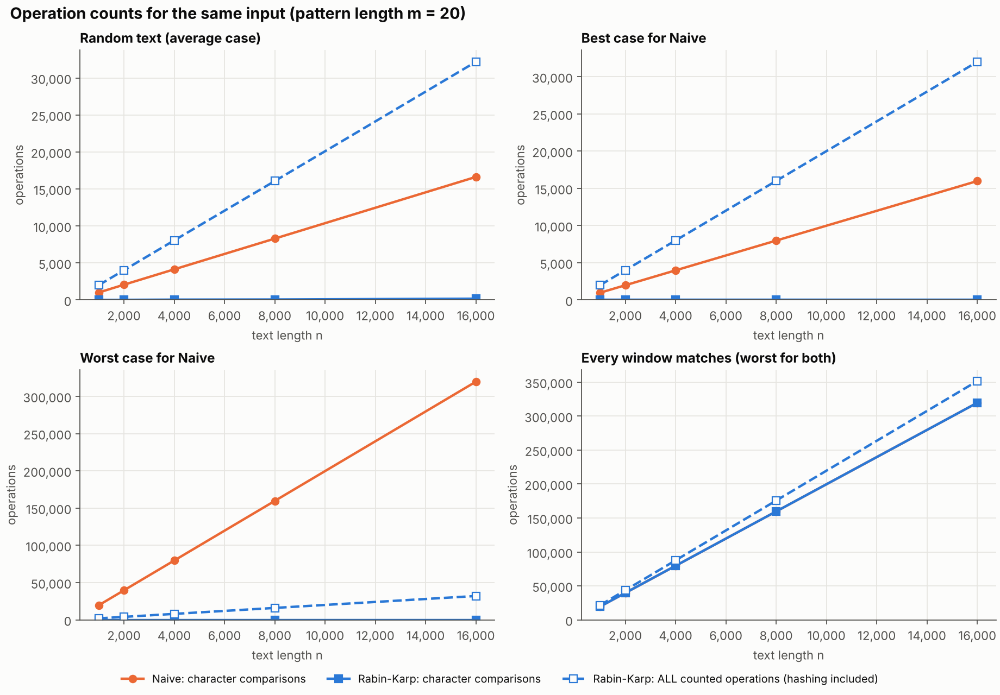

# Naive vs Rabin-Karp string matching

This runs the Naive and Rabin-Karp string matching algorithms on the same text and pattern and shows what each one does along the way. I built it as my Design and Analysis of Algorithms mini project in my final year of Computer Engineering at SPPU.

It isn't meant to be a fast search tool. Python already has `str.find` for that. The point is to count the work each algorithm does (character comparisons, hash comparisons, rolling-hash updates, spurious hits), so the difference between them is something you can read off a table instead of taking on faith.



## What came out of it

The short version: Rabin-Karp skips almost all of the character comparisons, but that doesn't make it cheaper overall. It hashes every window, which costs about 2n operations whether or not anything matches.

Numbers for a text of 16,000 characters and a pattern of 20 (exact counts, the random inputs are seeded):

| Input | Naive char. comparisons | Rabin-Karp char. comparisons | Rabin-Karp, all counted operations |
|---|---|---|---|
| Random text | 16,626 | 176 | 32,177 |
| Pattern almost matches everywhere (`aaa...ab`) | 319,620 | 0 | 32,001 |
| Every window really matches | 319,620 | 319,620 | 351,621 |

So Rabin-Karp wins clearly on the second row, where Naive does a lot of partial matching. On random text it does roughly twice the total work of Naive, and in pure Python it was also slower on the clock (about 1.8 times, in the run saved in `outputs/`). On the third row it can't help at all, because every window has to be checked anyway. Times depend on your machine, the operation counts don't.

The other thing worth seeing is a spurious hit, where two different strings get the same hash. With `d=10` and `q=13`, the window `67399` collides with the pattern `31415` at shift 12. The program checks the characters, sees they differ, and moves on. That's why the verification step exists.

## Running it

You need Python 3.8 or newer. Only the benchmark needs an extra package.

```
git clone https://github.com/<your-username>/string-matching-comparison.git
cd string-matching-comparison
pip install matplotlib          # only needed for benchmark.py
```

On Windows, if `python` isn't found, use `py` instead. On Mac and Linux, use `python3`.

The easiest way to see it: double-click `index.html`. It opens in your browser, with no install and no server. Pick an example or type your own text and pattern, and press Compare. It updates as you type. You get both algorithms' counters side by side, the matches highlighted in your text, a bar chart, a step-by-step trace you can click or step through with Prev/Next, and at the bottom the same graphs as `benchmark.py`, drawn live in the browser. It runs the same two algorithms as `matchers.py`, ported to JavaScript, and I checked that its counts match the Python on thousands of random inputs.

Or use the command line. Run the four prepared examples, each with a step-by-step trace:

```
python main.py --demo
```

Try your own input:

```
python main.py --text "abracadabra" --pattern "abra"
python main.py --text "abracadabra" --pattern "abra" --trace
python main.py --file notes.txt --pattern "needle"
```

For `abracadabra` and `abra` you should see both algorithms find shifts 0 and 7, with Naive making 16 character comparisons and Rabin-Karp 8.

Rabin-Karp's radix and modulus can be changed with `--d` and `--q` (defaults 256 and 101). The trace is only printed for texts up to 80 characters, to keep the screen readable.

Run the tests:

```
python -m unittest -v test_matchers
```

Regenerate the CSV and charts (takes around ten seconds, overwrites the files in `outputs/`):

```
python benchmark.py
```

## What's in here

| File | What it does |
|---|---|
| `matchers.py` | The two algorithms. Each returns the matches along with its operation counters |
| `trace.py` | Prints what each algorithm does at every shift |
| `main.py` | The command-line program |
| `index.html` | The browser version: same comparison, with side-by-side results and a clickable trace |
| `test_matchers.py` | 27 tests |
| `benchmark.py` | Three experiments: growing text, different moduli, different pattern lengths |
| `outputs/` | Saved results from one run: CSV, summary, demo output, test output and four charts |

Keep the `.py` files in the same folder, since they import each other.

## About the tests

Besides the usual known-answer and edge-case checks, every random test compares both algorithms against a plain slicing-based search. The small-alphabet tests with tiny moduli (q = 2 to 7) are the ones I rely on most, because they force lots of spurious hits. There are also tests that check the counters against the formulas: Naive's best case is exactly n-m+1 comparisons and its worst case is (n-m+1)·m.

## Things to know

- Hashes use `ord()` of each character, not digit values. For the pattern `31415` with `d=10` and `q=13`, working it out by hand with the digits 3, 1, 4, 1, 5 gives 7, but the program gives 10 because `ord('3')` is 51. The method is the same, only the numbers differ, and the collision at shift 12 happens either way.
- Pick an odd prime for `q`. If `d` and `q` share a factor (say `d=256` and `q=2`), the hash stops depending on most of the characters and spurious hits pile up. The results are still correct, just slow.
- Matching is exact and case-sensitive, one pattern at a time, and an empty pattern is rejected.
- The timings are pure Python on one machine. A compiled language could give a different picture, which I haven't tried.
- The spurious-hit experiment uses a single text and pattern, not an average over many.

## References

- Cormen, Leiserson, Rivest and Stein, *Introduction to Algorithms*, the chapter on string matching.
- Karp and Rabin, "Efficient randomized pattern-matching algorithms", *IBM Journal of Research and Development*, 31(2), 1987.

## Author

Tanishka Badhai , Computer Engineering Undergrad
